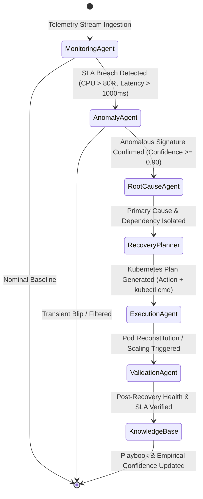

# Architectural Blueprint: Autonomous Self-Healing Cloud Infrastructure

## 1. System Philosophy
Traditional Site Reliability Engineering (SRE) relies on static alerts, runbooks, and manual on-call paging. This platform introduces **Autonomous Agentic Self-Healing**, where cognitive AI agents continuously inspect telemetry, formulate causal hypotheses, verify signatures against an empirical knowledge base, and execute targeted Kubernetes operations within seconds—reducing MTTR from minutes/hours to sub-10 seconds.

---

## 2. Multi-Agent State Machine (LangGraph)



---

## 3. Microservice Dependency Topology

```
                  ┌─────────────────┐
                  │   API GATEWAY   │
                  └────────┬────────┘
                           │
         ┌─────────────────┼─────────────────┐
         │                 │                 │
┌────────▼────────┐┌───────▼────────┐┌───────▼────────┐
│  Auth Service   ││  Ride Service  ││ Driver Service │
└─────────────────┘└───────┬────────┘└───────┬────────┘
                           │                 │
                  ┌────────▼────────┐        │
                  │  Trip Service   │◄───────┘
                  └────────┬────────┘
                           │
         ┌─────────────────┴─────────────────┐
         │                                   │
┌────────▼────────┐                 ┌────────▼────────┐
│ Pricing Service │                 │Location Service │
└─────────────────┘                 └─────────────────┘
```

---

## 4. Root Cause Signatures & Remediation Matrix

| Failure Signature | Symptom Metric | Root Cause Isolated | Autonomous Remediation Action |
| :--- | :--- | :--- | :--- |
| `UNBOUNDED_HEAP_MEMORY_LEAK` | Memory > 85%, Monotonic Growth | Heap object accumulation in active trip state | `kubectl rollout restart deployment/trip-deployment` & purge cache |
| `CPU_CORE_SATURATION` | CPU > 85%, High worker queue | Compute-intensive matrix matchmaking loop | `kubectl scale deployment/ride-deployment --replicas=3` |
| `CONTAINER_CRASH_LOOP` | Pod Status `CrashLoopBackOff` | Unhandled SIGSEGV or process termination | `kubectl delete pod --force --grace-period=0` |
| `DATABASE_LOCK_CONTENTION` | Latency > 1500ms, CPU normal | PostgreSQL pool exhausted, row locking | Terminate orphaned locks & rolling pod restart |
| `TRAFFIC_SURGE_CAPACITY_BREACH` | Requests > 500 RPS, 5xx errors | Ingress connection queue overflow | Horizontal Pod Autoscaling + Traffic Shedding |
| `NETWORK_IO_BOTTLENECK` | 504 Gateway Timeouts | Upstream network congestion or packet loss | Dynamic circuit breaker trip & routing failover |
